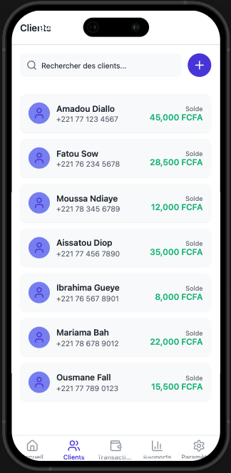
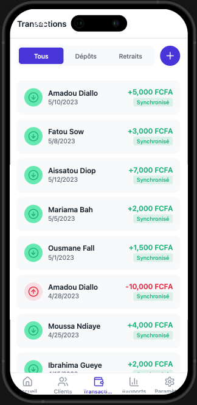
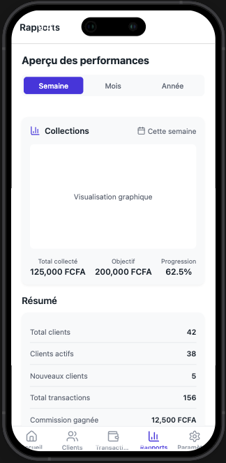
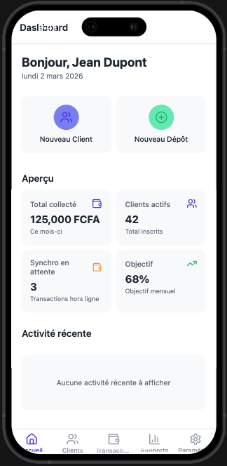

# 📱 ÉpargneMobile Ex: Yembi

<p align="center">
  
  
  
  
</p>


**ÉpargneMobile** est une application mobile de gestion d'épargne destinée aux agents de terrain en Afrique francophone. Elle permet de gérer les comptes clients, d'enregistrer les transactions (dépôts/retraits) et de suivre les performances, même sans connexion internet.

> **Note :** L'application est optimisée pour un usage **offline-first** afin de pallier les problèmes de connectivité dans les zones reculées.

---

## ✨ Fonctionnalités

* **Authentification :** Connexion sécurisée par ID Agent et PIN, inscription.
* **Tableau de bord :** Vue d'ensemble avec statistiques clés (total collecté, clients actifs, synchro en attente, objectifs).
* **Gestion des clients :** Recherche, ajout de nouveaux membres et scan KYC de pièces d'identité (code-barres).
* **Transactions :** Enregistrement rapide des flux financiers et suivi du statut de synchronisation.
* **Rapports :** Analyse des performances par période et export des données de collecte.
* **Paramètres :** Personnalisation (mode sombre), gestion du profil et mode hors ligne manuel.

---

## 🛠 Stack Technique

| Catégorie | Technologie |
| --- | --- |
| **Framework** | Expo SDK 54 + React Native 0.81 |
| **Routing** | Expo Router (file-based) |
| **Langage** | TypeScript |
| **State Management** | Zustand (persisté via AsyncStorage) |
| **Icônes** | `lucide-react-native` |
| **Caméra** | `expo-camera` (scan KYC) |
| **UI Enhancements** | `expo-blur`, `expo-linear-gradient`, `expo-haptics` |

---

## 📂 Structure du Projet

```text
app/
├── (auth)/                # Flux d'authentification (login, register, splash)
├── (app)/                 # Application principale (système d'onglets)
│   ├── dashboard.tsx      # Accueil et statistiques
│   ├── clients.tsx        # Répertoire client
│   ├── transactions.tsx   # Journal des flux
│   ├── reports.tsx        # Analytics
│   ├── settings.tsx       # Configuration
│   ├── clients/           # Sous-vues clients (details, add, scan)
│   └── transactions/      # Sous-vues transactions (details, new, withdraw)
├── _layout.tsx            # Layout racine (Providers)
└── index.tsx              # Point d'entrée
constants/                 # Thème (colors.ts)
hooks/                     # Hooks personnalisés
mocks/                     # Données de test (agents, clients, transactions)
stores/                    # Logique Zustand (auth, client, transaction)
types/                     # Interfaces TypeScript
utils/                     # Helpers (ID generator, network status)

```

---

## 🔑 Identifiants de Test

| ID Agent | Code PIN |
| --- | --- |
| `AGT001` | `1234` |
| `AGT002` | `5678` |

---

## ⚙️ Installation & Lancement

```bash
# 1. Installer les dépendances
bun install

# 2. Lancer le serveur de développement
bun start

# 3. Plateformes spécifiques
bun web      # Lancer sur navigateur
bun ios      # Lancer sur simulateur iOS
bun android  # Lancer sur émulateur Android

```

---

## 🏗 Architecture & Spécificités

* **Offline-first :** Toutes les données sont persistées localement. Un indicateur visuel permet de voir les transactions en attente de synchronisation avec le serveur.
* **Localisation :** Interface intégralement en **français** et gestion de la devise **FCFA**.
* **Compatibilité Web :** En l'absence de caméra physique sur PC, un fallback de saisie manuelle est prévu pour les données de pièces d'identité.


